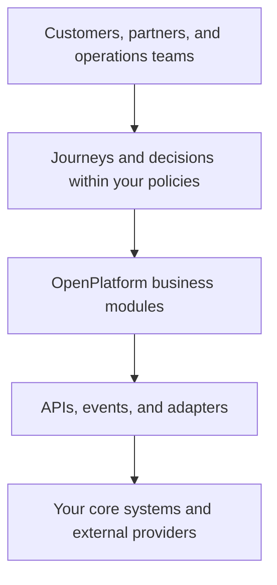

# Firefly Software

We run defined banking and insurance operations with AI agents and software. Each service has agreed inputs, acceptance criteria, service levels, and a clear owner for exceptions. Your institution keeps its policies and regulated decision authority.

This organization hosts the public business modules behind Firefly OpenPlatform. Our application frameworks and developer tools live in [Firefly Framework](https://github.com/fireflyframework).

[Website](https://fireflysoftware.io/) · [OpenPlatform](https://fireflysoftware.io/openplatform/) · [Services](https://fireflysoftware.io/services/) · [Discuss an operation](https://fireflysoftware.io/contact/)

## The technology behind the work

Firefly OpenPlatform combines business modules with your own services and existing systems through APIs and events. Use the capabilities that fit the operation, keep the systems that already work, and extend the parts your team owns.

*Conceptual composition. The service design defines the modules, integrations, and responsibilities for each implementation.*

The public modules cover customers, products, agreements, accounts, payments, lending, and shared services. Insurance implementations connect to the insurer's rating, underwriting, policy, and claims systems through adapters. Native insurance capabilities are being developed; the [platform overview](https://fireflysoftware.io/openplatform/#insurance-development) explains the current boundary.

## Explore the public modules

| Business area | Start with these repositories |
| --- | --- |
| Customers and onboarding | [Customer records](https://github.com/firefly-oss/core-common-customer-mgmt), [customer orchestration](https://github.com/firefly-oss/domain-customer-people), [onboarding journeys](https://github.com/firefly-oss/exp-onboarding) |
| Products and agreements | [Product definitions](https://github.com/firefly-oss/core-common-product-mgmt), [product catalog](https://github.com/firefly-oss/domain-product-catalog), [contracts](https://github.com/firefly-oss/core-common-contract-mgmt) |
| Accounts and financial records | [Accounts](https://github.com/firefly-oss/core-banking-accounts), [ledger](https://github.com/firefly-oss/core-banking-ledger), [general ledger](https://github.com/firefly-oss/core-common-accounting-gl) |
| Payments and cards | [Payments](https://github.com/firefly-oss/core-banking-payments), [cards](https://github.com/firefly-oss/core-banking-cards), [payment rails](https://github.com/firefly-oss/library-rails), [payment providers](https://github.com/firefly-oss/library-psps) |
| Lending | [Origination](https://github.com/firefly-oss/core-lending-loan-origination), [servicing](https://github.com/firefly-oss/core-lending-loan-servicing), [collections](https://github.com/firefly-oss/core-lending-delinquency-collections) |
| Shared services | [Documents](https://github.com/firefly-oss/core-common-document-mgmt), [notifications](https://github.com/firefly-oss/core-common-notification-services), [user management](https://github.com/firefly-oss/core-common-user-mgmt) |

Browse the [capability catalog](https://fireflysoftware.io/openplatform/modules/) for the wider portfolio, or read the [architecture](https://fireflysoftware.io/openplatform/architecture/) to understand the service boundaries.

## Operations we deliver

Each service delivers a unit of work your team can accept and measure.

| Service | Unit of work |
| --- | --- |
| [CreditOS](https://fireflysoftware.io/services/creditos/) | An accepted credit file |
| [ServicingOS](https://fireflysoftware.io/services/servicingos/) | An active loan account, serviced for the month |
| [CollectionsOS](https://fireflysoftware.io/services/collectionsos/) | An account under management |
| [UnderwritingOS](https://fireflysoftware.io/services/underwritingos/) | A complete submission, ready for your underwriter |
| [PolicyOS](https://fireflysoftware.io/services/policyos/) | A completed policy transaction |
| [ClaimsOS](https://fireflysoftware.io/services/claimsos/) | A completed claims stage |
| [OnboardingOS](https://fireflysoftware.io/services/onboardingos/) | A completed onboarding or refresh case |
| [ReconcileOS](https://fireflysoftware.io/services/reconcileos/) | A closed reconciliation cycle |
| [FinancialCrimeOS](https://fireflysoftware.io/services/financialcrimeos/) | An accepted investigation |
| [RiskOS](https://fireflysoftware.io/services/riskos/) | A completed close or model cycle |

These are managed services, with scope, coverage, integrations, and service levels agreed for each engagement. Open-source components retain their own licenses. AI works within approved limits; people with delegated authority handle significant or out-of-limit decisions. Read [how we operate](https://fireflysoftware.io/how-we-operate/) and [service levels and control](https://fireflysoftware.io/service-levels-and-control/).

## Start with one operation or one module

For an operational engagement, begin with an [operations review](https://fireflysoftware.io/contact/). We map the work, agree a Service Blueprint, deploy against acceptance criteria, and then run the service. Our [advisory](https://fireflysoftware.io/advisory/) helps teams decide what to keep, delegate, or rebuild.

For engineering, choose a repository from the catalog, read its setup instructions and license, and evaluate the dependencies and maturity for your use case. The [deployment guide](https://fireflysoftware.io/openplatform/get-started/) explains what a Firefly operation needs around the code. Report bugs and propose changes in the relevant repository; follow its contribution and security guidance.

## The wider Firefly ecosystem

[Firefly Framework](https://fireflyframework.org/) provides application frameworks for Java, Python, PHP, Rust, and .NET, alongside Forge for software delivery, Agentic for AI applications, and Weave for business processes. Firefly Software builds its services on this foundation.

[Explore the ecosystem](https://fireflysoftware.io/ecosystem/) · [Read our perspectives](https://fireflysoftware.io/#perspectives) · [About Firefly](https://fireflysoftware.io/company/)

The Firefly name and visual identity belong to Firefly Software Solutions Inc. Each repository defines its own code license.
